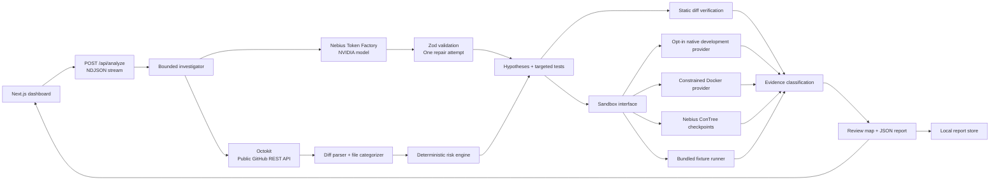

# AI Change Verifier

**AI writes code faster than humans can review it. We verify what actually needs human attention.**

A functional hackathon MVP for the **Nebius × NVIDIA Global AI Hackathon**. It turns a GitHub pull request into behavioral observations, bounded risk investigations, targeted test proposals, and an evidence-backed review map.

**Reproduce → Repair → Recheck:** investigate a finding with the same test at both pinned commits, inspect repeated assertion results, and request a bounded source repair that is tested inside an isolated sandbox. Export the evidence, unchanged test, harness, reproduction instructions, and proposed patch for human review.

## Run locally

Use **Node.js 22 LTS (22.13+) or 24 LTS** and npm. No database, API key, Docker, or remote sandbox is needed for the demo.

```bash
npm ci
npm run dev
```

Open **http://127.0.0.1:3000**, then click **Run the demo**. The app defaults to explicitly labeled demo mode when no Nebius key is configured and `DEMO_MODE` is unset. For explicit settings:

```powershell
# Windows PowerShell
Copy-Item .env.example .env.local
```

```bash
# macOS / Linux
cp .env.example .env.local
```

Use `DEMO_MODE=true` for a credential-free fixture walkthrough. To demonstrate actual NVIDIA/Nebius inference, use `DEMO_MODE=false` with the configured key and an exact eligible model; live repository execution additionally needs its sandbox configuration. Restart the server after changing environment variables.

Production build (still a local, single-user MVP):

```bash
npm run build
npm start
```

Both commands bind to loopback by default. Reports are stored in `.data/reports/` and survive server restarts on the same filesystem. The newest 100 are retained. There is no PostgreSQL dependency.

## Workspace navigation and product guide

Use **Local workspace** in the sidebar to open `/workspace`, which shows real saved-report counts, analyzed GitHub repositories, and recent activity. Repository rows open prefiltered analysis history. **Settings & integrations** replaces the decorative developer identity and opens `/settings`; the top-bar settings icon provides the same access on smaller screens.

Settings displays server configuration presence and execution prerequisites without exposing credential values or making provider test requests. Update `.env.local` on the server and restart to change configuration. A configured value is not evidence that network access or account permissions work.

**How it works** opens `/how-it-works`, a dedicated guide with quick start instructions, the full investigation pipeline, risk scoring, evidence status/provenance, analysis modes, execution requirements, review/follow-up tools, data limits, and FAQs. A linked contents list, fourteen-stage disclosure, and mobile Guide navigation make the detailed content accessible.

## Review workbench and action plan

Reports combine a searchable changed-file explorer, unified source diff with separate base/head line numbers, related findings, recorded test source, and evidence output. **Review focus** narrows the explorer to high-risk files, files with findings, or high-risk execution gaps. Search supports multiple path/category/status terms. Arrow keys, Home, and End navigate the visible file buttons; filtering preserves the selected file and labels it when outside the filter. The evidence inspector shows its saved review decision.

On live reports, **Check GitHub revision** reads current public repository/PR metadata using the server's GitHub integration. It compares both recorded commits, displays open/closed/merged/draft state, and offers reanalysis if either commit moved. No model or sandbox request is made. The check runs only when requested, remains an as-of snapshot, and a matching result expires after five minutes. Failures clear the previous match. Requests have a 25-second server deadline, a per-PR 15-second cooldown, two concurrent checks per process, authentication/origin protection, and actionable upstream errors. The standard public GitHub API limit applies; `GITHUB_TOKEN` is optional. Demo reports cannot query their illustrative PR.

**Next steps** creates a deterministic action plan from saved decisions and original report evidence. It prioritizes revision changes, needs-fix decisions, open findings, failed/inconclusive execution, missing build/type/existing-test execution, high-risk execution gaps, and incomplete diff context. Dismissing or reviewing a finding cannot erase failed checks or fill coverage gaps. Links open the corresponding finding, file, or evidence section. The plan does not incorporate newer reproduction/repair artifacts into the immutable report.

**Download action plan** creates a Markdown handoff with pinned commits, next steps, the current session's revision snapshot, saved notes, and evidence limitations. Save draft decisions first; exports never post to GitHub or approve a merge. The plan and revision check work without Nebius inference or Docker; live freshness requires GitHub network access.

Filter **Next steps** by decisions, evidence, revision, or scope; the download always includes the full plan. Each failed or inconclusive check links directly to its evidence and opens its output, including findings hidden by active filters. Standalone generated checks remain visible under Verification. Workbench **Needs review** and **Needs fix** filters use saved decisions and can be combined with search. **All retrieved changes** opens the selected file’s full patch. Revision retries show a countdown and respect the server’s `Retry-After` response.

## Reproduce, repair, and recheck

Open **Reproduce & repair** on a finding with a generated test, or use **Try reproduce & repair** on the overview. The dedicated page streams progress, saves the latest evidence separately from the original report, and survives reloads.

The assertion comparison shows each named assertion at base, head, and any repaired revision, including repeated-pass/fail, unstable, and missing results. A concise explanation identifies the result's limits and next action. During a rerun, the previous saved result is explicitly labeled. Saved evidence is shape-validated and checked against its test/source hashes, revisions, verdict, and repair checks before reuse; corrupt or stale records show a recovery message instead of enabling a repair.

1. **Reproduce:** run the identical generated Vitest source twice at each exact base/head commit, in separate Docker or Nebius checkouts. Record assertion identities, logs, durations, test hash, and runtime/image/dependency fingerprints. A stable base pass and head assertion failure support a regression finding; the expected behavior still needs human review.
2. **Repair:** after a reproduced regression, prepare a fresh head checkout and confirm the failure again. The configured Nebius model proposes one repair affecting at most three supplied, existing application source files. Hash guards, file-size limits, and path checks reject stale files, tests, configuration, symlinks, and hard links. No shell commands or arbitrary host writes are accepted as repair actions.
3. **Recheck:** keep the test unchanged, run it twice against patched source, then run build, typecheck, and existing tests. Before/after check results remain visible. A missing or failing required check prevents a validated repair label. Review and download the proposal; nothing is committed, merged, or posted to GitHub.

Live reproduction supports Vitest 3.2+ or 4, a supported root lockfile, matching dependency environments, and explicitly allowlisted **Docker or Nebius** execution. Native execution is excluded from this workflow. Changed assertions, skipped tests, runtime exceptions, unstable repeats, changed dependencies/images, and setup failures are inconclusive. The comparison uses the report's recorded base/head tips; it does not isolate every intervening change or establish complete coverage, causation, or merge safety.

The **demo walkthrough** actually executes trusted original/defective/repaired Node fixture variants. It uses a curated repair, no model inference, no GitHub checkout, and no repository build/type/test scripts. Synthetic report SHAs are illustrative. Demo results are labeled separately from live repository results.

Run the five curated evaluation cases:

```bash
npm run evaluate:regressions
```

Three intentionally introduced regressions and two healthy changes exercise repeated comparison and fixture repair. Output reports measured elapsed time and expected/observed classifications. This validates the curated workflow; it is not an AI accuracy benchmark or evidence of success on arbitrary repositories.

The JSON reproduction bundle includes named files: exact evidence, test source, isolated Vitest configuration for live runs, a README with commands, fixture variants for demo runs, and any proposed patch. Download the README/test/patch individually from the same page. Latest results are stored under `.data/regressions/`, separate from immutable analysis and reviewer notes. Older results for a finding are replaced only after a successful completed run; cancelled work preserves the previous result. Sidecar files are not automatically purged with the report retention policy.

Nebius inference and remote sandbox execution may be billable. A configured inference key does not enable repository execution; use the existing provider settings and allowlist in `.env.example`. Docker is the local option on Windows with Docker Desktop Linux containers. Remote sandbox credentials are separate from the inference key.

For the prepared Windows Docker path, follow [Docker setup](docs/DOCKER-WINDOWS.md). After installing/opening Docker Desktop, run `npm run docker:setup -- --repo OWNER/REPO` to check the engine, prepare the official image, and configure one exact repository while preserving your inference credentials. `npm run docker:check` checks readiness without changing configuration. A [three-minute demo outline](docs/DEMO.md) is included for the submission.

## Problem and solution

AI coding tools produce changes faster than humans can review them. A diff summary does not establish whether a changed behavior works, what was checked, or which areas deserve immediate attention.

AI Change Verifier separates the questions:

1. **Understand:** identify behavioral changes, affected systems and assumptions.
2. **Hypothesize:** select concrete risks with an explainable, configurable risk engine.
3. **Verify:** propose targeted tests and execute checks when an execution provider is available.
4. **Prioritize:** tie each finding to its source, evidence, file locations and remaining uncertainty.

The product never equates lower priority with safe code. Model output cannot assign evidence status or mark a live defect verified.

## Three-minute demo

1. Open the workspace and click **Run the demo** (or paste a valid PR URL while demo mode is enabled).
2. Follow 14 streamed stages: repository retrieval, behavioral understanding, risk hypotheses, test generation, execution and report assembly.
3. Open **Password reset token reuse** in the completed report.
4. Inspect four real assertions against the bundled, deliberately defective password-reset fixture: **3 pass, 1 fails**. Reusing the token returns 200; the assertion expects 400.
5. Expand **View generated verification test**, the test output, and the file diff.
6. Show the risk map, priority review surface, unavailable build/type/test checks, and agent event log.

The demo PR is synthetic: `acme/platform #127`, 18 files and 1,437 changed lines. Its diff excerpts are abbreviated. The priority line count is calculated from actual supplied diff lines and explicitly labeled a lower bound. The test template is curated, pre-generated demo content; it is not generated by a live model during demo mode. Fixture assertions execute at runtime in a bounded child Node process. They do **not** execute or verify the synthetic GitHub repository. External failures cannot silently turn a live analysis into demo evidence; the user can explicitly launch the demo instead.

## What works

| Capability                                                                                     | Status / requirements                                                                                                                      |
| ---------------------------------------------------------------------------------------------- | ------------------------------------------------------------------------------------------------------------------------------------------ |
| Responsive dashboard, progress stream, report, filters, expandable evidence/diffs, JSON export | Implemented                                                                                                                                |
| Demo investigation with actual fixture assertions                                              | Works without credentials, including Windows                                                                                               |
| Public GitHub metadata and paginated changed files                                             | Implemented using Octokit; optional `GITHUB_TOKEN` raises API limits                                                                       |
| Diff parsing, categorization, configurable risk engine, static checks                          | Implemented; no AI dependency                                                                                                              |
| Nebius structured inference and targeted Vitest generation                                     | Implemented; requires `NEBIUS_API_KEY` and a valid `NEBIUS_MODEL`                                                                          |
| AI category refinement and exact NVIDIA model catalog validation                               | Implemented with Zod validation and conservative fallback                                                                                  |
| Docker execution of explicitly trusted repositories                                            | Implemented for Linux containers, including Windows Docker Desktop; Docker required                                                        |
| Native development execution                                                                   | Explicit opt-in for trusted Linux/macOS/WSL repositories                                                                                   |
| Workspace access protection                                                                    | Public origin validation, owner authentication, CSP, bounded request bodies                                                                |
| Nebius ConTree sandbox                                                                         | REST adapter implemented; requires sandbox access, IAM token, project and image UUID                                                       |
| Local report history                                                                           | Implemented; filesystem persistence, newest 100 reports                                                                                    |
| Human review checklist and Markdown export                                                     | Saved decisions/notes per report and commit, decision filters, copy/download summary                                                       |
| Follow-up analysis and saved-run comparison                                                    | Rerun a PR; compare findings, evidence results, risk areas, and commit scope across retained runs                                          |
| Searchable report history                                                                      | Search by title, repository, PR number, or commit; filter by mode and high-priority findings                                               |
| Verification-gap explorer                                                                      | Search/filter changed files by risk and linked evidence; inspect scoped execution, static checks, skipped checks, and fixture-only results |
| Individual finding handoff                                                                     | Copy/download a focused Markdown draft with pinned commits, saved decision, evidence, and a follow-up checklist                            |
| Downloadable test proposals                                                                    | Download the recorded proposed test source for inspection; no test is generated or executed by downloading                                 |

Live NVIDIA/Nebius inference was validated at the checkpoint recorded in the validation log. Sandbox adapters also have mocked contract tests; real Docker/remote execution still requires the corresponding machine and account configuration.

Public GitHub retrieval was also smoke-tested through the production build without a token. See the [validation record](docs/VALIDATION.md) for exact checks and remaining integration validation.

## Architecture



The stack is Next.js App Router, React, TypeScript, Tailwind CSS, a shadcn-style Radix/CVA button primitive, Lucide icons, Octokit, Zod and Vitest. Server-only integration modules are imported only through route handlers/server components. Secrets are never passed as client props or `NEXT_PUBLIC_*` values.

```text
src/app/                    Landing, analyze, report, history and API routes
src/components/             Dashboard, input, progress, report and UI components
src/lib/agent/              Bounded investigation orchestration
src/lib/ai/                 Provider interface, prompts, Nebius adapter, schemas
src/lib/github/             Input validation, API client, PR retrieval, diff parser
src/lib/analysis/           File categories, fallback observations, blast radius
src/lib/risk/               Explicit scoring, explanations and review surface
src/lib/verification/       Static checks, execution and evidence classification
src/lib/sandbox/            Provider interface, native, Docker and Nebius executors
src/lib/demo/               Synthetic PR, curated test and executable fixture
src/lib/reports/            Local report storage
tests/                     Risk, evidence, provider, retrieval and demo tests
docs/                      Integration notes and screenshot checklist
```

## Agent workflow

`OBSERVE → THINK → HYPOTHESIZE → PLAN → GENERATE → EXECUTE → OBSERVE RESULT → CONCLUDE`

The default maximum is **5 investigations**, configurable from 1 to 10. The UI shows concise action summaries and actual observations, not hidden chain-of-thought. The model interface includes intent analysis, behavioral changes, risk hypotheses, verification plans, evidence summaries and final narratives. The MVP orchestrator deliberately renders evidence and final prioritization deterministically instead of allowing a model to upgrade statuses.

If a model request fails, deterministic observations and risk priorities remain. Invalid JSON/schema output receives exactly one repair attempt. A second failure produces a partial report. No alternate provider or model is silently substituted.

## Nebius and NVIDIA

For live analysis set:

```dotenv
DEMO_MODE=false
NEBIUS_API_KEY=your-server-side-key
NEBIUS_BASE_URL=https://api.tokenfactory.nebius.com/v1
NEBIUS_MODEL=an-NVIDIA-model-id-from-your-account
```

`NEBIUS_MODEL` intentionally has no hard-coded default. Before sending PR context, the adapter checks the exact ID against the account's `GET /v1/models` catalog. `NEBIUS_REQUIRE_NVIDIA=true` is the default and requires an `nvidia/` model ID; another vendor requires an explicit `false`. No model is silently substituted. Hackathon eligibility remains an account/event requirement.

After setting your key in `.env.local`, discover model IDs and verify structured output:

```bash
node scripts/verify-nebius.mjs --list
# Set NEBIUS_MODEL to an exact returned ID, then:
npm run verify:nebius
```

Listing makes no inference request; verification sends one small, potentially billable request. The adapter uses the documented OpenAI-compatible `POST /v1/chat/completions`, `messages`, `model`, `max_tokens`, and `response_format: {"type":"json_object"}`. Zod validates every result. See [integration notes](docs/INTEGRATIONS.md).

For GitHub-only analysis, set `DEMO_MODE=false` and leave the Nebius fields empty. You will get real metadata, static checks, path-based risk prioritization and clearly labeled heuristic observations; no model-generated tests or invented execution results.

## Risk engine

Scores are **review priority**, not a probability of a defect. Default thresholds: 0–24 LOW, 25–49 MEDIUM, 50+ HIGH. Every applied signal includes a reason.

| Signal                                   |  Weight |
| ---------------------------------------- | ------: |
| Authentication / authorization           | 30 / 35 |
| Database/persistence change              |      30 |
| Dependencies / environment configuration | 15 / 15 |
| Security-sensitive path                  |      25 |
| Removed or rewritten test definitions    |      30 |
| API path changed                         |      20 |
| Build / existing tests failed            | 50 / 50 |
| Generated assertion failed               |      40 |
| File diff over 300 lines                 |      10 |
| Runtime / infrastructure configuration   |      20 |
| Removed validation call                  |      30 |
| External email integration               |      25 |

Override supported keys with `RISK_WEIGHTS_JSON`, e.g. `{"authentication":35,"generatedTestFailed":45}`. Non-finite, negative, unsupported or >100 values are ignored. AI can add grounded categories missed by path heuristics; it cannot remove existing signals or disguise production code as tests. Test-file precedence is retained. The report labels category refinement as inference. Scores are recalculated with the same deterministic weights.

**Priority Review Surface** counts unique changed lines in high-risk files or high-priority finding ranges, distinguishing base-side deletions from head-side additions. Overlapping findings are deduplicated. Missing/truncated patches produce a partial-coverage warning; the denominator includes the PR's full declared additions and deletions.

## Verification and evidence

Static inspection covers dependency manifests, new environment references in added lines, potential API changes, database changes, and removed/rewritten tests. Visible package requirements and single-line API declaration changes are extracted when the diff provides enough context. A static PASS means inspection found no matching signal; it is not a runtime pass. API and migration checks do not establish compatibility.

Build, TypeScript and existing tests run only with a configured execution provider. Supported projects have one root npm, pnpm or Yarn lockfile; pnpm/Yarn require an exact `packageManager` version. Commands use declared scripts, with a local TypeScript `--noEmit` fallback when TypeScript and tsconfig.json exist. Generated Vitest tests use a dedicated configuration and JSON report, so a repository's test-exclude patterns cannot silently skip them. Dependency installation, cancellation, and cleanup outcomes remain visible. These are head-revision checks, not base/head regression comparisons. Unsupported checks remain **NOT AVAILABLE / NOT EXECUTED**.

Finding statuses:

- `UNVERIFIED_RISK`: no executed test supports a conclusion.
- `INCONCLUSIVE`: live generated test failure, timeout, syntax/configuration failure, or unparseable runner result. A broken test is not a confirmed product defect.
- `VERIFIED_FOR_TEST`: an executed generated test passed, limited to what that test actually asserted.
- `VERIFIED_ISSUE`: used automatically only for a failed, trusted assertion against the bundled demo fixture. Live failures require human assessment.

The dependency map shows potential connections inferred from categories, not a verified import graph.

## Human review checklist

Open a report and use **Your review** to see the checklist. Each finding has a **Decision** selector: Needs review, Needs fix, Reviewed, or Dismissed. Add an optional note (up to 2,000 characters) and click **Save decision**. Filter findings by decision to focus on remaining work. Saved decisions survive page reloads and server restarts.

Use **Copy Markdown** or **Download Markdown** to share a summary containing your saved decisions, notes, file references, verification evidence, and coverage limitations. Save pending drafts before exporting. The existing JSON export remains the original analysis. Nothing is automatically posted to GitHub, and this feature requires no additional credentials.

Decisions are tied to the exact report and head commit; reviewing or dismissing a finding does not change its evidence or verify a fix. Concurrent saves from another tab return a conflict and preserve your draft for review before retrying.

This is a shared checklist for the workspace owner. Review revision snapshots live in `.data/reviews/` on the same persistent filesystem as reports; earlier notes remain in those snapshots after edits. Report retention does not remove review snapshots. The sample report at `/report/demo` has its own stable checklist. Unsaved drafts exist only in the browser page, so save them before navigating away.

## Follow-up review and comparisons

On a saved report, click **Analyze again** to return to the PR form with its canonical GitHub URL filled in. Starting the form analyzes the latest PR revision using the configured providers and saves a separate report. Simply opening the prefilled form does not contact GitHub or run inference. Demo reports offer **Run demo again** instead.

Click **Compare runs** on the later saved report to compare it with an earlier analysis of the same repository, PR number, and mode. The latest eligible baseline is selected by default; choose another earlier run with the selector. Both runs show their full head/base commits, provider, date, priority-line scope, and coverage limitations. Finding groups distinguish **Newly observed**, **Observed in both runs**, and **Not observed in the later run**. Check results retain their recorded status and provenance. Risk-map changes show the recorded priority scores and file counts.

Matching requires the same title (ignoring case and whitespace), category, and affected file paths/diff sides. Line-number shifts and regenerated finding IDs do not break a match. Reworded or moved findings remain separate, and ambiguous duplicates are left unmatched. This compares saved observations; it does not execute a base/head regression test, prove that an absent finding was fixed, or transfer reviewer decisions. Differences in providers, base commits, repeated head commits, and partial coverage are explicitly identified. Comparisons require no additional credentials and use reports retained in local history (newest 100).

In **Analysis history**, search by repository, title, PR number, or commit prefix and combine the mode/priority filters. Filters are encoded in the URL, survive refresh and opening a report, and support browser Back/Forward. **Clear filters** restores the full list. History controls receive summary metadata rather than full diffs or execution output.

Analysis and reproduction progress use the same bounded UTF-8/NDJSON decoder and validated message schemas. A final message without a trailing newline is accepted. Silent streams time out, cancellation releases the reader, malformed gateway errors show actionable text, and rate limits retain the server's retry delay. If completion cannot be confirmed, reload the saved result before starting another potentially billable run.

## Verification gaps and finding handoff

Open **Evidence gaps** in a saved report to inspect changed files and their evidence links. Use **Show high-risk gaps**, file-path search, and the risk/evidence filters to focus the list. Expand a file to inspect recorded status/provenance, related findings, and diff limitations. **Inspect file diff** opens the matching diff; **Review related findings** clears finding filters and returns to the findings section. Longer lists load ten rows at a time.

An execution gap means no explicitly file-linked repository execution is recorded. Failed and warning executions remain labeled for review, and static PASS, NOT_RUN, and demo-fixture results never count as repository execution. Checks without paths are shown separately. File associations are not line coverage or proof that every behavior in a file was exercised; a repository-wide build pass does not mark every file verified. Missing patches and omitted file scope remain visible.

Within a finding, expand **Finding handoff & test proposal**. **Copy finding draft** and **Download finding draft** produce a focused Markdown draft containing the exact commits, affected code, evidence, saved review decision/note, recommendation, and follow-up checklist. Save pending edits to that finding before exporting. Drafts escape untrusted Markdown/HTML, exclude raw logs and generated source, and retain demo/coverage limitations. They are never posted to GitHub automatically.

**Download test proposal** is available when the report contains a nonempty generated test. The download preserves the recorded source, uses a bounded test-source filename, and does not run anything. Inspect imports, fixtures, assertions, and framework setup before execution. Demo templates remain clearly labeled. These tools use existing reports and require no additional credentials.

## Environment variables

| Variable                      | Default / purpose                                                                                             |
| ----------------------------- | ------------------------------------------------------------------------------------------------------------- |
| `DEMO_MODE`                   | `.env.example`: `true`. Unset: demo when no Nebius key exists. Explicit `false` enables real GitHub analysis. |
| `GITHUB_TOKEN`                | Optional server-only public GitHub token; never sent to the client or cloned repository.                      |
| `NEBIUS_API_KEY`              | Server-only inference credential.                                                                             |
| `NEBIUS_BASE_URL`             | `https://api.tokenfactory.nebius.com/v1`; clean HTTPS URL required.                                           |
| `NEBIUS_MODEL`                | Required for model inference; select an eligible NVIDIA model from your catalog.                              |
| `NEBIUS_REQUIRE_NVIDIA`       | `true`; require an exact available `nvidia/` model. Explicit `false` permits another selected vendor.         |
| `MAX_INVESTIGATIONS`          | `5`, bounded to 1–10; invalid values fall back to 5.                                                          |
| `SANDBOX_PROVIDER`            | `disabled`, `docker`, `native`, or `nebius`. Legacy local enablement without this setting selects native.     |
| `ENABLE_LOCAL_SANDBOX`        | `false`; explicit execution switch, always requires a trusted repository allowlist.                           |
| `LOCAL_SANDBOX_REPOSITORIES`  | Comma-separated public `OWNER/REPO` names explicitly trusted for local execution.                             |
| `SANDBOX_DOCKER_IMAGE`        | `node:22-bookworm`; must be present locally, resolved to its immutable image ID before execution.             |
| `ENABLE_NEBIUS_SANDBOX`       | `false`; explicit remote execution switch, requires its own repository allowlist.                             |
| `NEBIUS_SANDBOX_REPOSITORIES` | Comma-separated public `OWNER/REPO` names permitted for remote execution.                                     |
| `NEBIUS_SANDBOX_BASE_URL`     | `https://api.tokenfactory.nebius.com/sandboxes`; server-configured clean HTTPS endpoint.                      |
| `NEBIUS_SANDBOX_TOKEN`        | Server-only Nebius IAM bearer token with sandbox access; separate from inference configuration.               |
| `NEBIUS_SANDBOX_PROJECT_ID`   | Nebius project context, sent in the sandbox API's `Project` header.                                           |
| `NEBIUS_SANDBOX_IMAGE`        | Immutable UUID of an already imported, trusted Node 22+ image containing git and npm/Corepack.                |
| `ENABLE_PRODUCTION_SANDBOX`   | `false`; additional production opt-in for Docker or Nebius. Native execution always refuses production.       |
| `APP_ORIGIN`                  | Unset for loopback; exact HTTPS origin required for public hosting. Forwarded headers do not grant trust.     |
| `APP_AUTH_USERNAME`           | Owner username for HTTP Basic authentication. Required for public hosting; optional locally.                  |
| `APP_AUTH_PASSWORD`           | Owner password, at least 24 characters. Required with a username; server-only.                                |
| `RISK_WEIGHTS_JSON`           | Optional validated numeric weight overrides.                                                                  |
| `DATABASE_URL`                | Reserved for future persistence; unused and not required.                                                     |

## Security and execution limits

This is a **single-owner workspace**, not a multitenant service. Loopback use needs no login by default. A configured public workspace requires `APP_ORIGIN=https://your-host`, `APP_AUTH_USERNAME`, and a strong `APP_AUTH_PASSWORD`; the browser prompts for credentials. Authentication covers reports, history, and analysis, with an additional API-level check. Serve behind HTTPS with the original Host preserved. The supplied start commands remain loopback-bound. Do not expose a listener without configuring this boundary. Per-user access control, distributed quotas, encrypted storage, and operational monitoring remain deployment concerns.

Requests reject unconfigured public hosts and cross-origin analysis or review edits. A fresh script nonce protects each rendered page; inline style attributes remain permitted for report charts. Private responses are not cached, framing and object embedding are blocked, and request bodies are capped at 4 KB for analysis or 16 KB for review notes, with a 10-second read deadline.

The GitHub layer accepts only validated `github.com` repository/PR inputs, reads public repositories, pins analyzed head/base SHAs, and rejects a PR that changes during retrieval. Model context treats repository content as untrusted data. Zod rejects unexpected structures, invented file paths are discarded, and ungrounded line locations are removed. The model has no arbitrary tool or command interface.

Limits: two active analyses per process, 280-second overall analysis deadline, 20-second GitHub requests, 35-second model requests, 300 KB model response cap, 500 retrieved files, 20,000 patch characters per file, and model context capped at 60 risk-ordered files / 75,000 patch characters. These limits are disclosed in reports. Large or binary files may lack usable diffs.

**Docker execution** works from Windows with Docker Desktop running Linux containers, and from Linux/macOS with a compatible engine. It requires explicit enablement and the exact repository allowlist. Each analysis uses a disposable non-root container with a read-only root filesystem, bounded scratch filesystems, CPU/memory/PID limits, dropped capabilities, no privilege escalation, and no host directory or Docker socket mount. Application API keys are not passed into it. Clone/install can access the network; lifecycle scripts are disabled during installation. The network is detached and checked before repository scripts or generated tests execute. Commands have time/output limits and cleanup runs on cancellation and failure.

Pre-pull an approved image and configure `.env.local`:

```bash
docker pull node:22-bookworm
```

```dotenv
SANDBOX_PROVIDER=docker
ENABLE_LOCAL_SANDBOX=true
LOCAL_SANDBOX_REPOSITORIES=your-owner/your-repository
SANDBOX_DOCKER_IMAGE=node:22-bookworm
```

Restart `npm run dev` after configuration. Run `npm run test:sandbox` to exercise the real Docker integration. Production Docker execution additionally requires `ENABLE_PRODUCTION_SANDBOX=true`. Use a dedicated disposable worker/VM and trusted image; containers share a kernel and are not a complete hostile multitenant security boundary. Dependency installation still needs network access. Docker and live credentials were absent on the implementation host, so contract tests do not establish actual deployment isolation.

**Native execution** (`SANDBOX_PROVIDER=native`) remains for fully trusted Linux/macOS/WSL repositories in development only. It runs as your OS user and cannot isolate the host filesystem or network. It requires `ENABLE_LOCAL_SANDBOX=true` and an exact allowlist, always refuses production, and remains unavailable on native Windows. Use Docker for the Windows path.

Execution providers use controlled command IDs and reject traversal, escaping symlinks, and overwriting existing generated files. Reads may follow symlinks only within the checkout, supporting pnpm's dependency layout; writes reject symlinks. Generated checks require Vitest 3.2+ or 4, use an explicit isolated project, reject stale reports, and verify the reported test filename. Commands time out (60 seconds; installation 120 seconds) and console output is capped at 32 KB. Tests still need valid repository imports/fixtures; unsupported or invalid tests remain unavailable/inconclusive. A passing repository command does not invent assertion counts.

**Nebius remote execution** (`SANDBOX_PROVIDER=nebius`) uses the documented ConTree REST API and does not require Docker on the application host. Enable sandbox access in your Nebius project, obtain an IAM token, and import a trusted image containing Node 22+, git and npm/Corepack. Supply its immutable image UUID, not a mutable tag. See [remote setup and lifecycle details](docs/INTEGRATIONS.md#nebius-remote-execution).

```dotenv
SANDBOX_PROVIDER=nebius
ENABLE_NEBIUS_SANDBOX=true
NEBIUS_SANDBOX_REPOSITORIES=your-owner/your-repository
NEBIUS_SANDBOX_BASE_URL=https://api.tokenfactory.nebius.com/sandboxes
NEBIUS_SANDBOX_TOKEN=your-server-side-iam-token
NEBIUS_SANDBOX_PROJECT_ID=your-project-id
NEBIUS_SANDBOX_IMAGE=your-imported-image-uuid
```

The adapter runs as a non-root user, pins the analyzed Git commit, and carries workspace state between remote checkpoints. Only clone/install operations enable networking; repository checks and generated tests run with networking disabled. Application secrets are never injected into the execution environment. Production additionally requires `ENABLE_PRODUCTION_SANDBOX=true`. Stopping an analysis requests cancellation of active operations; checkpoint cleanup follows the service's retention policy and is not immediate erasure. The [Nebius beta overview](https://docs.tokenfactory.nebius.com/sandboxes/overview) currently describes 180-day checkpoint retention with possible removal of untagged, unreferenced images afterward. This adapter creates no tags or imports automatically. Live access and image compatibility must be checked with your account.

Run `npm run test:nebius-sandbox` to check the configured account and image. It loads `.env.local`, performs billable remote checks, and retains one tiny public fixture checkpoint under Nebius's retention policy. It checks checkpoint persistence, offline execution, exit codes, and cancellation. The default test suite skips this opt-in check. Inference can be checked separately with `npm run verify:nebius`.

## Troubleshooting GitHub analysis

GitHub requests run on the app server. A working browser connection does not establish that the Node.js process can reach `api.github.com`. If the error mentions blocked access or DNS resolution and the app was started in a restricted coding-agent terminal, stop that server and start the existing project from a regular Windows PowerShell window:

```powershell
cd "D:\Codex Projects\AI code reviewer"
node .\node_modules\next\dist\bin\next dev --hostname 127.0.0.1 --port 3001
```

Open `http://127.0.0.1:3001`. Other installations should use their own project directory. If the server still cannot connect, check its DNS, VPN, firewall and proxy settings. Public PRs work without `GITHUB_TOKEN`; adding a token can raise GitHub's API limit but cannot repair blocked network access. Add or update it only in `.env.local`, then restart the server.

Each GitHub request has a 20-second deadline and at most two retries for transient connection failures or HTTP 408/500/502/503/504 responses. Authentication, missing PRs, access restrictions and rate limits are reported immediately; rate-limit messages include the available retry time. Cancelling the analysis also cancels any pending retry.

## Validation

```bash
npm run lint
npm run typecheck
npm test
npm run build
```

Tests exercise URL boundaries, hunk line accounting, score thresholds and overrides, deduplication, incomplete coverage, evidence states, production execution gates, malformed model output/repair, GitHub revision drift/errors, and the complete streamed demo investigation. Browser QA covers the input → progress → report flow, generated test/output expansion, risk filtering and history.

## Limitations and roadmap

Live AI and remote sandbox execution need separate account configuration; inference billing, sandbox access and NVIDIA availability vary by account. Static checks remain conservative and generated tests may require repository-specific imports/setup/fixtures. Root Node projects are supported; monorepo orchestration and other languages are not. Reports, owner authentication, and concurrency controls are local to one process/host; persistent disks are required when self-hosting. No claim of full behavioral coverage or multitenant production readiness is made.

Next: compare regression tests against base and head revisions, support more test frameworks and monorepos, add an actual import graph and contract snapshots, and introduce a durable job queue. Later: GitHub App / Actions, opt-in PR comments, Slack notifications, organization history, IDE integrations, and enterprise access control. These are not part of the MVP.

## Screenshots and submission

See [screenshot checklist](docs/SCREENSHOTS.md) for the three recommended submission captures. The UI identifies demo data and verification limitations in every relevant view.

- Project: **AI Change Verifier**
- Event: **Nebius × NVIDIA Global AI Hackathon**
- Submission pitch: **An autonomous verification layer for AI-generated software.**
- Demo: run locally and follow the three-minute sequence above.
- Team, submission URL and recorded video: add your team's details before submitting.
