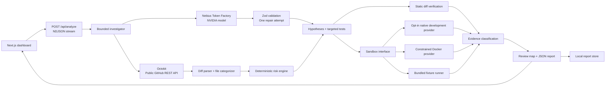

# AI Change Verifier

**AI writes code faster than humans can review it. We verify what actually needs human attention.**

A functional hackathon MVP for the **Nebius × NVIDIA Global AI Hackathon**. It turns a GitHub pull request into behavioral observations, bounded risk investigations, targeted test proposals, and an evidence-backed review map.

## Run locally

Use **Node.js 22 LTS (22.13+) or 24 LTS** and npm. No database, API key, Docker, or remote sandbox is needed for the demo.

```bash
npm ci
npm run dev
```

Open **http://127.0.0.1:3000**, then click **Run the demo**. The app defaults to explicitly labeled demo mode when no Nebius key is configured and `DEMO_MODE` is unset. For explicit settings:

```powershell
# Windows PowerShell
Copy-Item .env.example .env.local
```

```bash
# macOS / Linux
cp .env.example .env.local
```

Keep `DEMO_MODE=true` for judging. Restart the development server after changing environment variables.

Production build (still a local, single-user MVP):

```bash
npm run build
npm start
```

Both commands bind to loopback by default. Reports are stored in `.data/reports/` and survive server restarts on the same filesystem. The newest 100 are retained. There is no PostgreSQL dependency.

## Problem and solution

AI coding tools produce changes faster than humans can review them. A diff summary does not establish whether a changed behavior works, what was checked, or which areas deserve immediate attention.

AI Change Verifier separates the questions:

1. **Understand:** identify behavioral changes, affected systems and assumptions.
2. **Hypothesize:** select concrete risks with an explainable, configurable risk engine.
3. **Verify:** propose targeted tests and execute checks when an execution provider is available.
4. **Prioritize:** tie each finding to its source, evidence, file locations and remaining uncertainty.

The product never equates lower priority with safe code. Model output cannot assign evidence status or mark a live defect verified.

## Three-minute demo

1. Open the workspace and click **Run the demo** (or paste a valid PR URL while demo mode is enabled).
2. Follow 14 streamed stages: repository retrieval, behavioral understanding, risk hypotheses, test generation, execution and report assembly.
3. Open **Password reset token reuse** in the completed report.
4. Inspect four real assertions against the bundled, deliberately defective password-reset fixture: **3 pass, 1 fails**. Reusing the token returns 200; the assertion expects 400.
5. Expand **View generated verification test**, the test output, and the file diff.
6. Show the risk map, priority review surface, unavailable build/type/test checks, and agent event log.

The demo PR is synthetic: `acme/platform #127`, 18 files and 1,437 changed lines. Its diff excerpts are abbreviated. The priority line count is calculated from actual supplied diff lines and explicitly labeled a lower bound. The test template is curated, pre-generated demo content; it is not generated by a live model during demo mode. Fixture assertions execute at runtime in a bounded child Node process. They do **not** execute or verify the synthetic GitHub repository. External failures cannot silently turn a live analysis into demo evidence; the user can explicitly launch the demo instead.

## What works

| Capability                                                                                     | Status / requirements                                                               |
| ---------------------------------------------------------------------------------------------- | ----------------------------------------------------------------------------------- |
| Responsive dashboard, progress stream, report, filters, expandable evidence/diffs, JSON export | Implemented                                                                         |
| Demo investigation with actual fixture assertions                                              | Works without credentials, including Windows                                        |
| Public GitHub metadata and paginated changed files                                             | Implemented using Octokit; optional `GITHUB_TOKEN` raises API limits                |
| Diff parsing, categorization, configurable risk engine, static checks                          | Implemented; no AI dependency                                                       |
| Nebius structured inference and targeted Vitest generation                                     | Implemented; requires `NEBIUS_API_KEY` and a valid `NEBIUS_MODEL`                   |
| AI category refinement and exact NVIDIA model catalog validation                               | Implemented with Zod validation and conservative fallback                           |
| Docker execution of explicitly trusted repositories                                            | Implemented for Linux containers, including Windows Docker Desktop; Docker required |
| Native development execution                                                                   | Explicit opt-in for trusted Linux/macOS/WSL repositories                            |
| Workspace access protection                                                                    | Public origin validation, owner authentication, CSP, bounded request bodies         |
| Nebius ConTree sandbox                                                                         | Extension boundary documented; instance-specific adapter is not connected           |
| Local report history                                                                           | Implemented; filesystem persistence, newest 100 reports                             |

Live credentials were not supplied during development. Adapter validation and failures are tested with mocked HTTP responses; a live inference request still requires account validation.

Public GitHub retrieval was also smoke-tested through the production build without a token. See the [validation record](docs/VALIDATION.md) for exact checks and remaining integration validation.

## Architecture



The stack is Next.js App Router, React, TypeScript, Tailwind CSS, a shadcn-style Radix/CVA button primitive, Lucide icons, Octokit, Zod and Vitest. Server-only integration modules are imported only through route handlers/server components. Secrets are never passed as client props or `NEXT_PUBLIC_*` values.

```text
src/app/                    Landing, analyze, report, history and API routes
src/components/             Dashboard, input, progress, report and UI components
src/lib/agent/              Bounded investigation orchestration
src/lib/ai/                 Provider interface, prompts, Nebius adapter, schemas
src/lib/github/             Input validation, API client, PR retrieval, diff parser
src/lib/analysis/           File categories, fallback observations, blast radius
src/lib/risk/               Explicit scoring, explanations and review surface
src/lib/verification/       Static checks, execution and evidence classification
src/lib/sandbox/            Provider interface, local executor, remote extension
src/lib/demo/               Synthetic PR, curated test and executable fixture
src/lib/reports/            Local report storage
tests/                     Risk, evidence, provider, retrieval and demo tests
docs/                      Integration notes and screenshot checklist
```

## Agent workflow

`OBSERVE → THINK → HYPOTHESIZE → PLAN → GENERATE → EXECUTE → OBSERVE RESULT → CONCLUDE`

The default maximum is **5 investigations**, configurable from 1 to 10. The UI shows concise action summaries and actual observations, not hidden chain-of-thought. The model interface includes intent analysis, behavioral changes, risk hypotheses, verification plans, evidence summaries and final narratives. The MVP orchestrator deliberately renders evidence and final prioritization deterministically instead of allowing a model to upgrade statuses.

If a model request fails, deterministic observations and risk priorities remain. Invalid JSON/schema output receives exactly one repair attempt. A second failure produces a partial report. No alternate provider or model is silently substituted.

## Nebius and NVIDIA

For live analysis set:

```dotenv
DEMO_MODE=false
NEBIUS_API_KEY=your-server-side-key
NEBIUS_BASE_URL=https://api.tokenfactory.nebius.com/v1
NEBIUS_MODEL=an-NVIDIA-model-id-from-your-account
```

`NEBIUS_MODEL` intentionally has no hard-coded default. Before sending PR context, the adapter checks the exact ID against the account's `GET /v1/models` catalog. `NEBIUS_REQUIRE_NVIDIA=true` is the default and requires an `nvidia/` model ID; another vendor requires an explicit `false`. No model is silently substituted. Hackathon eligibility remains an account/event requirement.

After setting your key in `.env.local`, discover model IDs and verify structured output:

```bash
node scripts/verify-nebius.mjs --list
# Set NEBIUS_MODEL to an exact returned ID, then:
npm run verify:nebius
```

Listing makes no inference request; verification sends one small, potentially billable request. The adapter uses the documented OpenAI-compatible `POST /v1/chat/completions`, `messages`, `model`, `max_tokens`, and `response_format: {"type":"json_object"}`. Zod validates every result. See [integration notes](docs/INTEGRATIONS.md).

For GitHub-only analysis, set `DEMO_MODE=false` and leave the Nebius fields empty. You will get real metadata, static checks, path-based risk prioritization and clearly labeled heuristic observations; no model-generated tests or invented execution results.

## Risk engine

Scores are **review priority**, not a probability of a defect. Default thresholds: 0–24 LOW, 25–49 MEDIUM, 50+ HIGH. Every applied signal includes a reason.

| Signal                                   |  Weight |
| ---------------------------------------- | ------: |
| Authentication / authorization           | 30 / 35 |
| Database/persistence change              |      30 |
| Dependencies / environment configuration | 15 / 15 |
| Security-sensitive path                  |      25 |
| Removed or rewritten test definitions    |      30 |
| API path changed                         |      20 |
| Build / existing tests failed            | 50 / 50 |
| Generated assertion failed               |      40 |
| File diff over 300 lines                 |      10 |
| Runtime / infrastructure configuration   |      20 |
| Removed validation call                  |      30 |
| External email integration               |      25 |

Override supported keys with `RISK_WEIGHTS_JSON`, e.g. `{"authentication":35,"generatedTestFailed":45}`. Non-finite, negative, unsupported or >100 values are ignored. AI can add grounded categories missed by path heuristics; it cannot remove existing signals or disguise production code as tests. Test-file precedence is retained. The report labels category refinement as inference. Scores are recalculated with the same deterministic weights.

**Priority Review Surface** counts unique changed lines in high-risk files or high-priority finding ranges, distinguishing base-side deletions from head-side additions. Overlapping findings are deduplicated. Missing/truncated patches produce a partial-coverage warning; the denominator includes the PR's full declared additions and deletions.

## Verification and evidence

Static inspection covers dependency manifests, new environment references in added lines, potential API changes, database changes, and removed/rewritten tests. Visible package requirements and single-line API declaration changes are extracted when the diff provides enough context. A static PASS means inspection found no matching signal; it is not a runtime pass. API and migration checks do not establish compatibility.

Build, TypeScript and existing tests run only with a configured execution provider. Supported projects have one root npm, pnpm or Yarn lockfile; pnpm/Yarn require an exact `packageManager` version. Commands use declared scripts, with a local TypeScript `--noEmit` fallback when TypeScript and tsconfig.json exist. Generated Vitest tests use a dedicated configuration and JSON report, so a repository's test-exclude patterns cannot silently skip them. Dependency installation, cancellation, and cleanup outcomes remain visible. These are head-revision checks, not base/head regression comparisons. Unsupported checks remain **NOT AVAILABLE / NOT EXECUTED**.

Finding statuses:

- `UNVERIFIED_RISK`: no executed test supports a conclusion.
- `INCONCLUSIVE`: live generated test failure, timeout, syntax/configuration failure, or unparseable runner result. A broken test is not a confirmed product defect.
- `VERIFIED_FOR_TEST`: an executed generated test passed, limited to what that test actually asserted.
- `VERIFIED_ISSUE`: used automatically only for a failed, trusted assertion against the bundled demo fixture. Live failures require human assessment.

The dependency map shows potential connections inferred from categories, not a verified import graph.

## Environment variables

| Variable                     | Default / purpose                                                                                             |
| ---------------------------- | ------------------------------------------------------------------------------------------------------------- |
| `DEMO_MODE`                  | `.env.example`: `true`. Unset: demo when no Nebius key exists. Explicit `false` enables real GitHub analysis. |
| `GITHUB_TOKEN`               | Optional server-only public GitHub token; never sent to the client or cloned repository.                      |
| `NEBIUS_API_KEY`             | Server-only inference credential.                                                                             |
| `NEBIUS_BASE_URL`            | `https://api.tokenfactory.nebius.com/v1`; clean HTTPS URL required.                                           |
| `NEBIUS_MODEL`               | Required for model inference; select an eligible NVIDIA model from your catalog.                              |
| `NEBIUS_REQUIRE_NVIDIA`      | `true`; require an exact available `nvidia/` model. Explicit `false` permits another selected vendor.         |
| `MAX_INVESTIGATIONS`         | `5`, bounded to 1–10; invalid values fall back to 5.                                                          |
| `SANDBOX_PROVIDER`           | `disabled`, `docker`, or `native`. Legacy enablement without this setting selects native.                     |
| `ENABLE_LOCAL_SANDBOX`       | `false`; explicit execution switch, always requires a trusted repository allowlist.                           |
| `LOCAL_SANDBOX_REPOSITORIES` | Comma-separated public `OWNER/REPO` names explicitly trusted for local execution.                             |
| `SANDBOX_DOCKER_IMAGE`       | `node:22-bookworm`; must be present locally, resolved to its immutable image ID before execution.             |
| `ENABLE_PRODUCTION_SANDBOX`  | `false`; additional production opt-in for Docker only. Native execution always refuses production.            |
| `APP_ORIGIN`                 | Unset for loopback; exact HTTPS origin required for public hosting. Forwarded headers do not grant trust.     |
| `APP_AUTH_USERNAME`          | Owner username for HTTP Basic authentication. Required for public hosting; optional locally.                  |
| `APP_AUTH_PASSWORD`          | Owner password, at least 24 characters. Required with a username; server-only.                                |
| `RISK_WEIGHTS_JSON`          | Optional validated numeric weight overrides.                                                                  |
| `DATABASE_URL`               | Reserved for future persistence; unused and not required.                                                     |

## Security and execution limits

This is a **single-owner workspace**, not a multitenant service. Loopback use needs no login by default. A configured public workspace requires `APP_ORIGIN=https://your-host`, `APP_AUTH_USERNAME`, and a strong `APP_AUTH_PASSWORD`; the browser prompts for credentials. Authentication covers reports, history, and analysis, with an additional API-level check. Serve behind HTTPS with the original Host preserved. The supplied start commands remain loopback-bound. Do not expose a listener without configuring this boundary. Per-user access control, distributed quotas, encrypted storage, and operational monitoring remain deployment concerns.

Requests reject unconfigured public hosts and cross-origin analysis. A fresh script nonce protects each rendered page; inline style attributes remain permitted for report charts. Private responses are not cached, framing and object embedding are blocked, and request bodies are capped at 4 KB with a 10-second read deadline.

The GitHub layer accepts only validated `github.com` repository/PR inputs, reads public repositories, pins analyzed head/base SHAs, and rejects a PR that changes during retrieval. Model context treats repository content as untrusted data. Zod rejects unexpected structures, invented file paths are discarded, and ungrounded line locations are removed. The model has no arbitrary tool or command interface.

Limits: two active analyses per process, 280-second overall analysis deadline, 20-second GitHub requests, 35-second model requests, 300 KB model response cap, 500 retrieved files, 20,000 patch characters per file, and model context capped at 60 risk-ordered files / 75,000 patch characters. These limits are disclosed in reports. Large or binary files may lack usable diffs.

**Docker execution** works from Windows with Docker Desktop running Linux containers, and from Linux/macOS with a compatible engine. It requires explicit enablement and the exact repository allowlist. Each analysis uses a disposable non-root container with a read-only root filesystem, bounded scratch filesystems, CPU/memory/PID limits, dropped capabilities, no privilege escalation, and no host directory or Docker socket mount. Application API keys are not passed into it. Clone/install can access the network; lifecycle scripts are disabled during installation. The network is detached and checked before repository scripts or generated tests execute. Commands have time/output limits and cleanup runs on cancellation and failure.

Pre-pull an approved image and configure `.env.local`:

```bash
docker pull node:22-bookworm
```

```dotenv
SANDBOX_PROVIDER=docker
ENABLE_LOCAL_SANDBOX=true
LOCAL_SANDBOX_REPOSITORIES=your-owner/your-repository
SANDBOX_DOCKER_IMAGE=node:22-bookworm
```

Restart `npm run dev` after configuration. Run `npm run test:sandbox` to exercise the real Docker integration. Production Docker execution additionally requires `ENABLE_PRODUCTION_SANDBOX=true`. Use a dedicated disposable worker/VM and trusted image; containers share a kernel and are not a complete hostile multitenant security boundary. Dependency installation still needs network access. Docker and live credentials were absent on the implementation host, so contract tests do not establish actual deployment isolation.

**Native execution** (`SANDBOX_PROVIDER=native`) remains for fully trusted Linux/macOS/WSL repositories in development only. It runs as your OS user and cannot isolate the host filesystem or network. It requires `ENABLE_LOCAL_SANDBOX=true` and an exact allowlist, always refuses production, and remains unavailable on native Windows. Use Docker for the Windows path.

Both providers use controlled command IDs and reject traversal, symlink paths, and overwriting existing generated files. Commands time out (60 seconds; installation 120 seconds) and console output is capped at 32 KB. Generated tests still need valid repository imports/fixtures; missing framework support or invalid tests remain unavailable/inconclusive. A passing repository command does not invent assertion counts.

The remote Nebius ConTree adapter remains intentionally unavailable until provisioned and implemented. The working provider selection supports Docker and native execution; it does not fabricate Nebius sandbox methods.

## Validation

```bash
npm run lint
npm run typecheck
npm test
npm run build
```

Tests exercise URL boundaries, hunk line accounting, score thresholds and overrides, deduplication, incomplete coverage, evidence states, production execution gates, malformed model output/repair, GitHub revision drift/errors, and the complete streamed demo investigation. Browser QA covers the input → progress → report flow, generated test/output expansion, risk filtering and history.

## Limitations and roadmap

Live AI needs account credentials; inference billing and NVIDIA availability vary by account. The remote Nebius sandbox is unfinished. Static checks remain conservative and generated tests may require repository-specific imports/setup/fixtures. Root Node projects are supported; monorepo orchestration and other languages are not. Reports, owner authentication, and concurrency controls are local to one process/host; persistent disks are required when self-hosting. No claim of full behavioral coverage or multitenant production readiness is made.

Next: connect the isolated ConTree adapter, compare regression tests against base and head revisions, support more test frameworks and monorepos, add an actual import graph and contract snapshots, and introduce a durable job queue. Later: GitHub App / Actions, opt-in PR comments, Slack notifications, organization history, IDE integrations, and enterprise access control. These are not part of the MVP.

## Screenshots and submission

See [screenshot checklist](docs/SCREENSHOTS.md) for the three recommended submission captures. The UI identifies demo data and verification limitations in every relevant view.

- Project: **AI Change Verifier**
- Event: **Nebius × NVIDIA Global AI Hackathon**
- Submission pitch: **An autonomous verification layer for AI-generated software.**
- Demo: run locally and follow the three-minute sequence above.
- Team, submission URL and recorded video: add your team's details before submitting.
